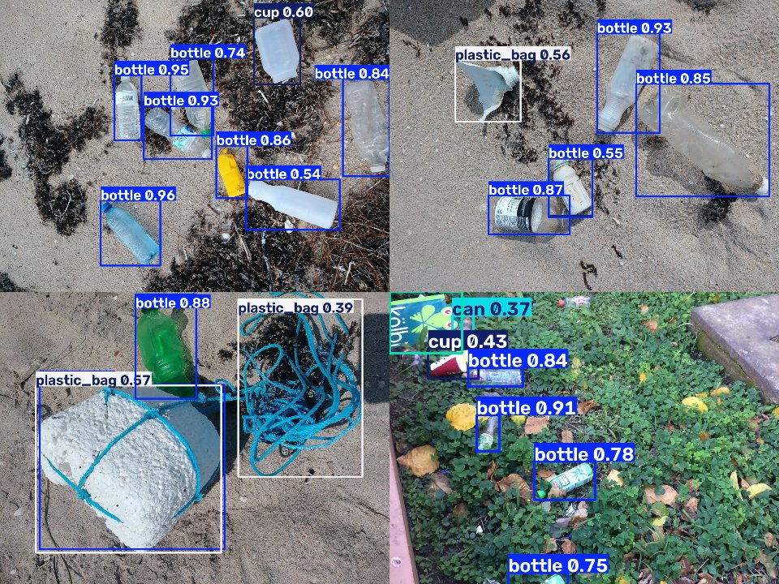
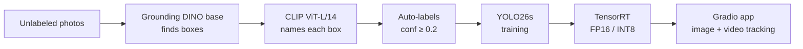
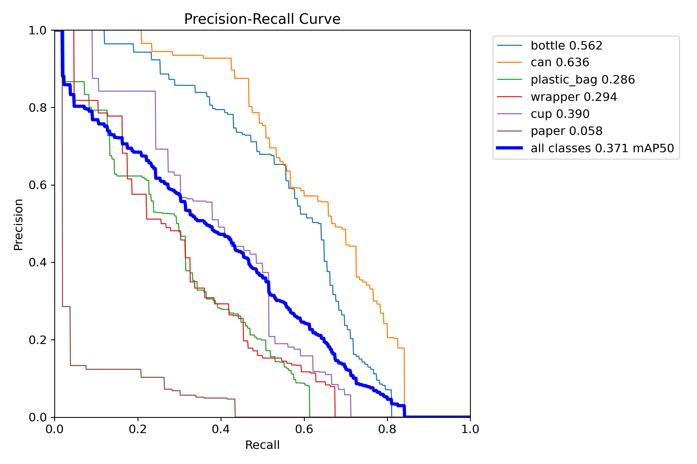
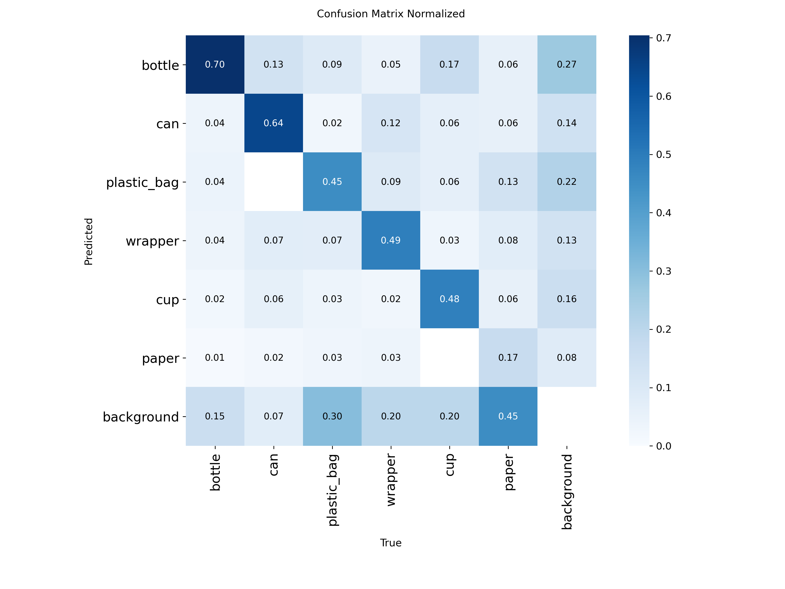
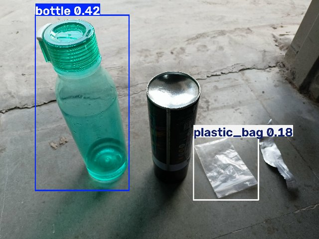

# TrashSpotter: a litter detector trained with zero hand-drawn labels

A real-time litter detector (bottle, can, plastic bag, wrapper, cup, paper) whose training labels were made **entirely by AI**. An open-vocabulary teacher (Grounding DINO + CLIP) labels unlabeled photos, a YOLO26s student learns from those labels, and TensorRT makes it run at **210 FPS** on a 4 GB laptop GPU.


*Model predictions on test images it never saw during training (PlastOPol and TACO test sets).*

## Highlights

- **No manual labeling:** the student trained only on auto-labels **beats the same model trained on 1,000 human-labeled images**: 0.370 vs 0.314 mAP50 on the human-labeled TACO test set.
- **Teacher → student distillation:** the student keeps most of the teacher's accuracy at **~270× the speed** (4.75 ms vs ~1.3 s per image).
- **Domain adaptation without labels:** adding auto-labeled photos from a new source improved detection on unseen real-world scenes by **+25%** (0.424 → 0.532 mAP50) without hurting the original benchmark.
- **Measured, not guessed:** every design choice below comes from an experiment on a fixed, human-labeled test set, with metrics computed the same way as Ultralytics.

## How it works



1. **Grounding DINO** (open-vocabulary detector) is prompted with text such as "plastic bottle. soda can. ..." and proposes boxes.
2. **CLIP** looks at each cropped box and picks the class from text descriptions ("a crisp packet", "a paper cup", ...), or rejects it as "other" (leaf, rock, cardboard...). Final score = detector score × CLIP probability.
3. Boxes with confidence ≥ 0.2 become YOLO training labels.
4. **YOLO26s** is trained on these labels and exported to **TensorRT**.
5. A **Gradio** app detects litter in images, and tracks and counts it in videos (ByteTrack, each object counted once).

## Results

All numbers are on held-out test sets with **human** labels that were never used for training.

### 1. Building the auto-labeler (TACO test, 500 images)

| Labeler | mAP50 | mAP50-95 |

|---|---|---|
| Grounding DINO tiny | 0.149 | 0.117 |
| Grounding DINO base | 0.296 | 0.244 |
| Grounding DINO base, one prompt per class | ≈0.36* | – |
| **Grounding DINO base + CLIP reclassification** | **0.462** | **0.363** |

\*on 100 images; 6× slower, so rejected.

**Key finding:** Grounding DINO *finds* litter well (class-agnostic mAP50 0.639) but often gives it the **wrong name**. Phrases in one prompt compete: for example, "cup" alone found 48 cups, but inside the full prompt it found 0. Letting CLIP name the boxes fixed this: **+56% mAP50**, with wrapper going from 0.047 to 0.465 and cup from 0.000 to 0.497.

### 2. Student vs. human labels

| Model | Training labels | TACO mAP50 | TACO mAP50-95 | PlastOPol mAP50† |

|---|---|---|---|---|
| Teacher (Grounding DINO + CLIP) | none (zero-shot) | 0.462 | 0.363 | 0.415 |
| A: YOLO26s | 1,000 images, **human** labels | 0.314 | 0.238 | 0.341 |
| B: YOLO26s | 4,831 images, **auto**-labels | 0.365 | 0.269 | 0.424 |
| **B-v2: YOLO26s** | B + 742 PlastOPol images, **auto**-labels | **0.370** | **0.275** | **0.532** |

†PlastOPol test (484 images) has one-class labels ("litter"), so it is evaluated class-agnostically. It is an **out-of-domain** test: photos from a different source than the training data.

Per-class mAP50 on TACO:

| | bottle | can | plastic_bag | wrapper | cup | paper |

|---|---|---|---|---|---|---|
| A (human labels) | 0.517 | 0.494 | **0.298** | 0.256 | 0.284 | 0.034 |
| B-v2 (auto-labels) | **0.561** | **0.636** | 0.286 | **0.293** | **0.389** | **0.058** |

### 3. Speed (TensorRT, RTX 3050 Laptop 4 GB)

| Format | Size | mAP50 | mAP50-95 | ms / image | FPS |

|---|---|---|---|---|---|
| PyTorch | 20.3 MB | 0.365 | 0.269 | 10.0 | 100 |
| **TensorRT FP16** | 22.5 MB | 0.358 | 0.260 | 4.75 | **210** |
| TensorRT INT8 | 12.7 MB | 0.333 | 0.243 | 3.86 | 259 |

Measured on model B with batch 1, end-to-end (resize + model + postprocess) on a 4624×3468 phone photo, median of 300 runs. INT8 was calibrated on training images only. **FP16 is the sweet spot:** 2.1× faster for −0.007 mAP50.

<p float="left">
  
  
</p>

## Lessons learned

- **Measure the failure before fixing it.** A class-agnostic evaluation showed the teacher's problem was naming, not finding, which pointed straight to CLIP.
- **Auto-label noise shows up late in training.** B peaked at epoch 65 of 100, B-v2 at epoch 10 of 30; after that, the student starts memorizing the teacher's mistakes. With `last.pt` instead of `best.pt`, B still beats A (0.325 vs 0.309).
- **"The teacher found nothing" is not the same as "nothing is there".** In a dataset where every photo contains litter, those images were dropped instead of being used as background.
- **Classic bugs found by testing:** EXIF rotation in phone photos, RGB vs. BGR (brown leaves turned blue and became "plastic bags"), video codecs that browsers can't play, and duplicate counting in tracking (fixed with a minimum track length and class majority vote).

## Limitations



- **Domain gap:** on my own indoor photo above, the bottle and packet are found, but a **matte-black upright can and crumpled foil are missed**. The training data has mostly outdoor, crushed, colorful litter. The teacher does detect this can (0.69), so auto-labeling ~200 local photos is the next step.
- **Student inherits teacher blind spots:** wrapper recall is low (≈30%) because Grounding DINO rarely proposes boxes for crumpled packaging.
- **Fuzzy classes:** wrapper vs. plastic bag vs. film is ambiguous even for humans.
- `best.pt` was selected on the TACO test set (for both A and B; the comparison holds with `last.pt` too).

## Reproduce

Tested on Ubuntu 22.04, Python 3.10, RTX 3050 Laptop (4 GB), 16 GB RAM.

```bash
git clone https://github.com/Rehbar25/trashspotter.git && cd trashspotter
python -m venv .venv && source .venv/bin/activate
pip install -r requirements.txt

# 1. Data: TACO (github.com/pedropro/TACO) into data/taco, PlastOPol (zenodo.org/records/5829156) into data/plastopol
python src/prepare_taco.py && python src/split_taco.py
python src/prepare_unlabeled.py            # TACO "unofficial" images = unlabeled pool
python src/prepare_plastopol.py

# 2. Teacher: auto-label (repeat for each image list)
python src/predict_gdino.py --images data/unlabeled/all.txt --out runs/autolabel/pool_gdino
python src/clip_reclassify.py --preds runs/autolabel/pool_gdino --images data/unlabeled/all.txt --out runs/autolabel/pool_clip
python src/build_autolabel.py --images data/unlabeled/all.txt --preds runs/autolabel/pool_clip --name pool

# 3. Evaluate any prediction folder against the human-labeled test set
python src/evaluate.py --preds runs/autolabel/... --conf 0.2

# 4. Student: train, then export to TensorRT
yolo detect train model=yolo26s.pt data=configs/data_auto_v2.yaml epochs=100 imgsz=640 batch=8
yolo export model=runs/.../best.pt format=engine half=True imgsz=640 batch=1
python src/benchmark.py --weights runs/.../best.pt runs/.../best_fp16.engine

# 5. Demo app
python src/app.py --weights runs/.../best_fp16.engine
```

## Project structure

```configs/   classes + prompts (classes.yaml), dataset configs
src/       detector.py, clip_classifier.py      teacher models
           predict_gdino.py, clip_reclassify.py auto-labeling stages
           build_autolabel.py                   auto-labels → YOLO dataset
           evaluate.py                          mAP evaluation (Ultralytics-compatible)
           prepare_*.py, split_taco.py          dataset conversion
           benchmark.py                         PyTorch vs TensorRT
           app.py                               Gradio demo (image + video tracking)
docs/      README images
```

## Acknowledgements and licenses

- **TACO** (Proença & Simões, 2020): annotations CC BY 4.0; images under their individual licenses.
- **PlastOPol** (Córdova et al., *Sensors* 2022): CC BY 4.0, images from Marine Debris Tracker.
- **Grounding DINO** (IDEA Research, Apache 2.0), **CLIP** (OpenAI, MIT), **Ultralytics YOLO** (AGPL-3.0).
